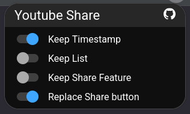

# Youtube URL share
Extension that simplifies `video` and `shorts` url sharing by removing unnecessary parameters.

## How to build
### My environment:

* `NodeJS` v26.12.1
* `npm` 12.2.1
* `Cachy OS`

### Steps:
1. `npm ci`
2. `npm run zip:firefox` or `npm run zip:chrome`
3. look in `./.output/`
